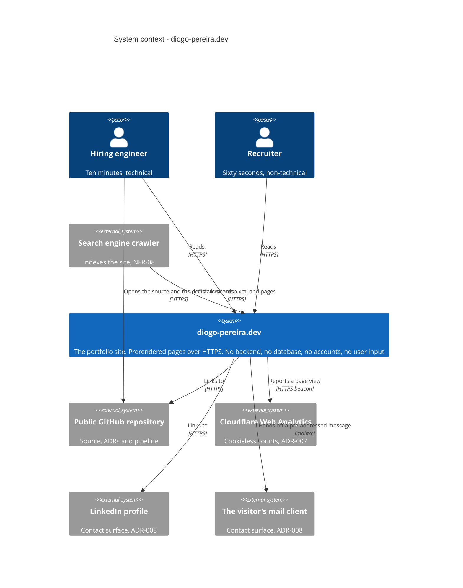
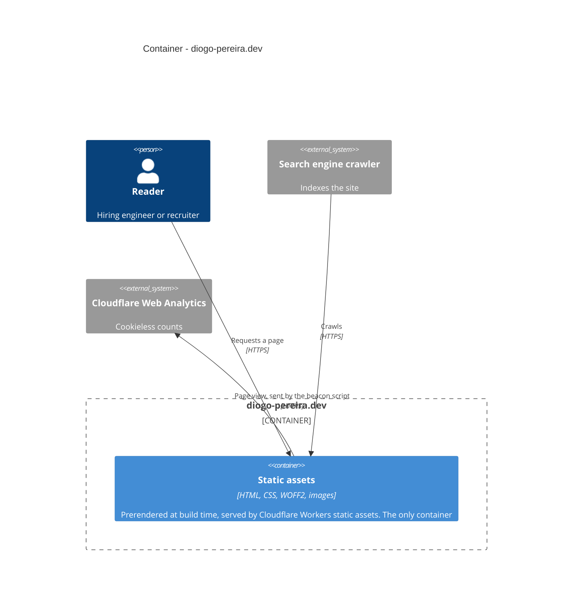

# Architecture

What this system is, what it talks to, and what it is deliberately not.

The diagrams are C4 — a way of drawing software architecture at four zoom levels, where
each level is a step closer in. They are written as Mermaid in this file rather than
exported as images, so a change to the architecture shows up as a diff rather than as a
replaced picture nobody can review.

US-32. Companion to the architecture decision records in `docs/adr/`, which say _why_ each
of these choices was made; this file says _what_ the result is.

---

## How to read these

| Level            | What it shows                                    | Drawn here           |
| ---------------- | ------------------------------------------------ | -------------------- |
| 1 System context | The system, its users, and the systems around it | Yes                  |
| 2 Container      | The separately deployable or runnable parts      | Yes                  |
| 3 Component      | The parts inside one container                   | No — see below       |
| 4 Code           | Classes and functions                            | No — rarely worth it |

A **container** in C4 is a separately deployable or runnable thing — an application, a
service, a database, a browser application. It has nothing to do with Docker.

---

## Level 1 — System context

**The two people are the two readers from `docs/discovery.md` §2**, in that order of
priority. The engineer is the one who leaves this diagram's system and opens the
repository, which is why that relationship is drawn: the site's job is partly to hand
somebody over to the evidence.

**The `mailto:` relationship is initiated by the visitor**, not by the site. The arrow is
drawn from the site because the site is what supplies the address; nothing is sent until
somebody clicks. There is no contact form and no mail service — ADR-008.

**Everything external here is public.** No system in this diagram is an employer's, and
nothing crosses the confidentiality boundary in `docs/discovery.md`.

---

## Level 2 — Container

**There is one container, and that is the finding rather than a gap.**

A site with a client-side application would have a second: the JavaScript running in the
visitor's browser. Since ADR-015 there is no first-party JavaScript at all, so the browser
renders a document rather than running an application. A site with a backend would have a
third, and a database a fourth. This has none of them.

The one qualification worth stating precisely: **the site is not script-free.** The
cookieless analytics beacon is third-party JavaScript, about 10,300 bytes per route, and
it is the only script delivered. `tests/e2e/no-hydration.spec.ts` asserts the absence of
_first-party_ scripts specifically, so that the beacon cannot quietly be used to justify
weakening the assertion.

Being able to say "one container, and here is why that is correct rather than
unfinished" is the point of having drawn it.

---

## How that container is produced

Not a container diagram, because a build pipeline is not a container — it is how the
container comes to exist. In prose rather than drawn:

A push to a branch runs the pipeline in `.github/workflows/ci.yml`: ESLint, Prettier,
`nuxt typecheck`, a production build, an internal link check, a preview deployment, the
Playwright suites against that preview, and the Lighthouse budgets. On merge to `main` the
same build is deployed to production with `wrangler`. GitHub Actions is the deployment
trigger rather than Cloudflare's own Git integration — ADR-009 — and the target is an
assets-only Worker rather than Cloudflare Pages — ADR-010, superseding ADR-004.

A deployment diagram showing runners, environments and the deploy credential would be a
reasonable addition. It is not drawn here because US-32 asks for Levels 1 and 2, and
adding it would be scope taken rather than given.

---

## Artefacts deliberately absent

Knowing which artefacts a system does not need, and being able to say why, is worth as
much as producing them.

**No entity-relationship diagram.** An entity-relationship diagram shows database tables
and how they relate. There is no database and no data model. The only structured data is
the frontmatter on two markdown files, validated against a zod schema while the build runs
— a file format, not a schema in a database. ADR-003, ADR-012.

**No OpenAPI contract.** OpenAPI is a machine-readable specification of an HTTP API's
endpoints, their parameters and their responses. There is no API. There is no server to
host one: every route is a file produced at build time. ADR-002.

**No C4 Level 3.** A component diagram decomposes one container into its internal parts.
One container holding prerendered files has nothing to decompose. Drawing Vue components
here would be a file listing wearing an architecture diagram's clothes.

**No sequence diagrams.** A sequence diagram is for an interaction worth tracing across
several participants. The only interaction here is a browser requesting a file and
receiving it.

**No threat model diagram.** The threat model is written rather than drawn, because what
matters is the reasoning — the realistic attacks here are against the domain registration,
the GitHub account and the deploy credential, none of which appear in a diagram of the
running system. See `docs/discovery.md` and ADR-016.

---

## Notation

Mermaid's `C4Context` and `C4Container`, rendered by GitHub directly from this file.

Verified rather than assumed: the syntax was tested in GitHub's own markdown renderer
before this file was written, because Mermaid documents its C4 diagram types as
experimental and GitHub bundles its own Mermaid version. If a future GitHub change stops
rendering these, the fallback is Mermaid's `flowchart`, which carries the same information
in labels rather than in syntax. The diagrams would read as source until then, which is
the failure worth knowing about in advance.

Structurizr DSL was considered and rejected. It is the canonical C4 tool, but GitHub shows
it as plain text, so using it means adding a rendering step and committing generated
images — and US-32 asks for text, specifically so the architecture is reviewable in a
diff.
